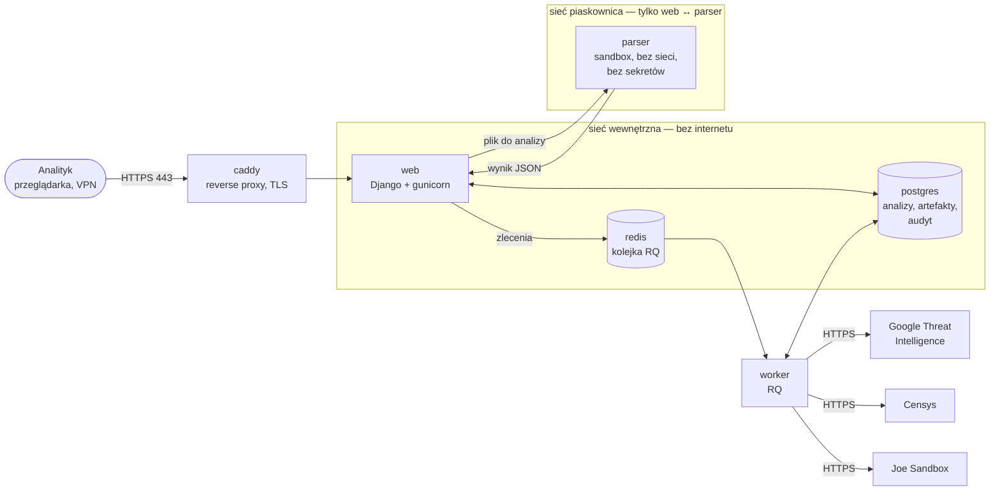
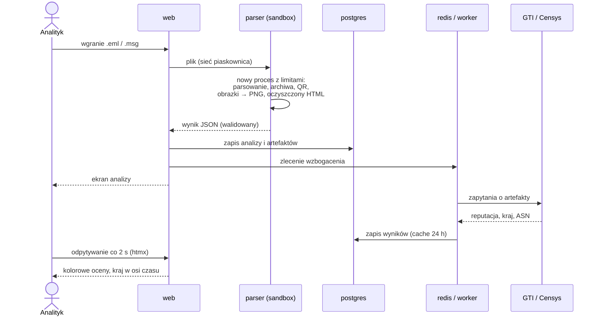
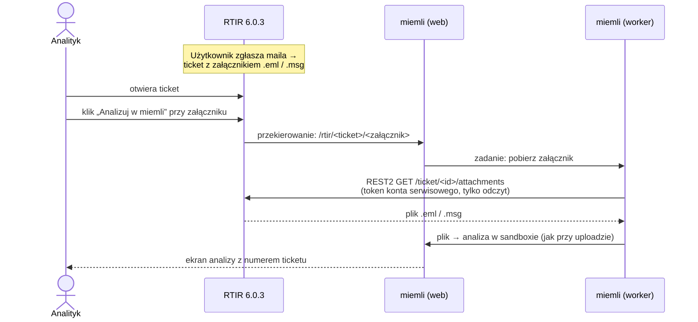

# miemli — opis dla zespołu

Wewnętrzne narzędzie CSIRT do **bezpiecznej analizy podejrzanych wiadomości** `.eml` / `.msg`
zgłaszanych w RTIR. Analityk wgrywa plik i po kilku sekundach widzi czytelny podgląd, ocenę
nagłówków, artefakty z reputacją oraz może jednym kliknięciem wysłać mail do Joe Sandbox.

---

## 1. Do czego służy

| Funkcja | Co daje analitykowi |
|---|---|
| **Bezpieczny podgląd** | Treść maila jak u ofiary: bez skryptów, bez klikalnych linków, bez pobierania obrazków z internetu. Przyciski wyglądają jak w oryginale, w miejscu zewnętrznego obrazka jest ramka z jego domeną |
| **Nagłówki i oś czasu** | SPF / DKIM / DMARC, sygnały podszywania (Reply-To, Return-Path, darmowa poczta), ścieżka serwerów z krajem i ASN, anomalie czasu (cofanie, długi postój, data w przyszłości), X-Mailer, łańcuch ARC |
| **Artefakty** | Adresy e-mail, domeny, IP, URL-e (też z kodów QR i przekierowań SafeLinks), pliki z hashami, hasła do archiwów. Drzewo pokazuje, skąd każdy artefakt pochodzi |
| **Archiwa i zagnieżdżenia** | ZIP / 7z / RAR (także z hasłem podanym w treści), mail w mailu |
| **Reputacja** | Automatyczne sprawdzenie artefaktów w Google Threat Intelligence i Censys (cache 24 h) |
| **Joe Sandbox** | Wysyłka całego maila z kontem analityka, śledzenie statusu i werdyktu |
| **„Czy to już było?”** | Wyszukiwarka po hashu, IP, e-mailu, URL-u, domenie (z subdomenami) i tekście; odznaki „w N innych analizach” |
| **Werdykt i audyt** | Phishing / malware / BEC / oszustwo / spam / test / czysty / do weryfikacji, widoczny na liście; dziennik działań dla administratora |

Typowe zastosowania:
- szybka ocena zgłoszenia użytkownika („czy to phishing?”),
- zebranie wskaźników do ticketu i do blokad (DNS, proxy, poczta),
- powiązanie nowego zgłoszenia z wcześniejszymi kampaniami,
- bezpieczne zdetonowanie próbki w Joe bez ręcznego pobierania pliku na stację.

---

## 2. Technologie

| Warstwa | Technologia |
|---|---|
| Aplikacja | Python 3.14, Django 6.1 |
| Interfejs | Szablony Django + htmx (bez frameworka JS), motyw Nord (ciemny) |
| Parsowanie poczty | `email` (stdlib), extract-msg (.msg), pyzipper / py7zr / unar (archiwa), BeautifulSoup + nh3 (oczyszczanie HTML), Pillow (obrazy), zxing-cpp (QR) |
| Baza danych | PostgreSQL 17 |
| Kolejka zadań | Redis 7 + RQ (zadania jako JSON, lista dozwolonych zadań) |
| Serwer WWW | Caddy (HTTPS), gunicorn |
| Izolacja | Docker; parser w osobnym kontenerze, na produkcji w gVisor |
| Integracje | GTI (VirusTotal API), Censys Platform, Joe Sandbox Cloud |
| Testy | pytest — ponad 600 testów automatycznych |

---

## 3. Kontenery i przepływ informacji



| Kontener | Rola | Dostęp do sieci | Sekrety |
|---|---|---|---|
| **caddy** | HTTPS dla analityków | internet / sieć firmowa | certyfikat |
| **web** | strony, logowanie, zapis wyników | tylko sieci wewnętrzne | `SECRET_KEY`, hasło bazy; **bez kluczy API** |
| **parser** | dekodowanie plików (potencjalnie złośliwych) | wyłącznie połączenie od `web` | **żadnych** |
| **worker** | zapytania do GTI / Censys / Joe | wewnętrzna + internet | klucze API, klucz prywatny Joe |
| **postgres** | dane | tylko sieć wewnętrzna | hasło bazy |
| **redis** | kolejka zadań | tylko sieć wewnętrzna | hasło Redisa |

### Przebieg jednej analizy



**Oryginalny plik nie jest zapisywany** — tylko wynik analizy. Do Joe trafia po ponownym wgraniu
(sprawdzany SHA256) albo od razu przy uploadzie (checkbox).

---

## 4. Bezpieczeństwo

- **Parser w piaskownicy:** osobny kontener bez sieci, bez sekretów i bez bazy; każdy plik w świeżym
  procesie z limitami (1 GB RAM, 30 s CPU, 60 s czasu); na produkcji dodatkowo **gVisor** (osobne
  jądro w przestrzeni użytkownika — ochrona przed ucieczką z kontenera).
- **Wynik parsera traktowany jak wrogi:** `web` waliduje typy, rozmiary i głębokość JSON-a.
- **Obrazki przekodowywane do PNG**, nietypowe (np. TIFF udający PNG) oznaczane w raporcie.
- **Podgląd:** HTML przez allowlistę (nh3), iframe `sandbox`, CSP `default-src 'none'`.
- **Klucze:** API tylko w `worker`; klucze Joe analityków zaszyfrowane kluczem publicznym, odszyfrować
  może tylko `worker`.
- **Kontenery:** system plików tylko do odczytu, bez uprawnień (capabilities), limity pamięci i procesów.
- **Kolejka:** zadania jako JSON (nie pickle) i lista dozwolonych funkcji w workerze.
- **Konta:** lokalne, hasła min. 12 znaków, zmiana hasła wylogowuje inne sesje, audyt dla admina.

---

## 5. Scenariusz integracji z RTIR (planowany)

> Integracja nie jest jeszcze zaimplementowana — poniżej proponowany przebieg do omówienia.

### 5.1 Jak plik trafia do miemli



- Analiza jest powiązana z ticketem (`ticket_id`, `attachment_id`); ponowne kliknięcie otwiera
  istniejącą analizę zamiast tworzyć nową.
- Plik dla Joe może być pobrany ponownie z RTIR — bez ręcznego wgrywania.
- miemli łączy się z RTIR **kontem serwisowym** o minimalnych uprawnieniach.

### 5.2 Co miemli odsyła do RTIR

Po kliknięciu **„Wyślij do RTIR”** (decyzja analityka, nie automat):

| Element | Gdzie w RTIR | Przykład |
|---|---|---|
| **Komentarz z podsumowaniem** | komentarz w tickecie | werdykt analityka, wyniki SPF/DKIM/DMARC, sygnały podszywania, anomalie osi czasu |
| **Artefakty (IOC)** | pola IP / Domain / URL / Hash (custom fields RTIR) | `185.243.115[.]20`, `pko-platnosci[.]example`, SHA256 załącznika |
| **Werdykt Joe** | komentarz | „Joe: złośliwy 48/100” + link do analizy Joe |
| **Link do analizy** | komentarz | `https://miemli/analiza/123/` |
| **Powiązania** | komentarz | „Ta domena wystąpiła w 3 innych analizach (tickety #4512, #4630, #4711)” |

Przykładowy komentarz:

```text
[miemli] Analiza #123 — werdykt: PHISHING (anna)
Uwierzytelnienie: SPF fail · DKIM none · DMARC fail
Sygnały: Reply-To w innej domenie (gmail.com); darmowa poczta
Oś czasu: czas cofa się o 20 min na 2. serwerze
Artefakty: 7 (1 złośliwy w GTI: hxxps://pko-platnosci[.]example/login)
Joe Sandbox: złośliwy 48/100 — https://jbxcloud.joesecurity.org/analysis/...
Wcześniej widziane: pko-platnosci[.]example — tickety #4512, #4630
Szczegóły: https://miemli.csirt.local/analiza/123/
```

---

## 6. Udostępnienie w sieci zespołu (do testów)

Kroki na serwerze / stacji z Dockerem:

1. W `.env` ustawić nazwę hosta lub IP, pod którym koledzy wejdą, np.
   `MIEMLI_HOST=miemli.csirt.local`, `ALLOWED_HOSTS=miemli.csirt.local`,
   `CSRF_TRUSTED_ORIGINS=https://miemli.csirt.local`.
2. Wpis DNS (albo `hosts`) wskazujący tę nazwę na adres maszyny.
3. Otworzyć port **443/TCP** tylko z sieci zespołu / VPN (zapora hosta).
4. Certyfikat: na test `tls internal` w Caddy (przeglądarka pokaże ostrzeżenie); docelowo certyfikat
   z firmowego CA.
5. `docker compose up -d --build`, potem konta dla kolegów w `/admin/` (każdy zmieni hasło w profilu).
6. Na czas testów: **nie wgrywać prawdziwych zgłoszeń z danymi osobowymi**, jeśli parser nie działa
   w gVisor (aplikacja pokazuje wtedy czerwony baner).

---

## 7. Stan i dalsze kroki

- ✅ Rdzeń analizy, archiwa, QR, podgląd, sandbox parsera, GTI/Censys, Joe Sandbox, werdykty, audyt,
  zmiana hasła, oś czasu nagłówków, wyszukiwarka.
- ⏳ **Etap C:** proxy wychodzące dla workera (ruch tylko do GTI, Censys, Joe).
- ⏳ **Integracja z RTIR** (sekcja 5).
- ⏳ Produkcja: gVisor, certyfikat z firmowego CA, kopie zapasowe bazy.
